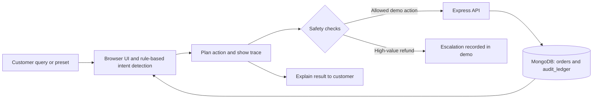

# ResolvAI

ResolvAI is an e-commerce customer-support demo built for Homingo Hack Days 2026, Track 1: Agents (Planning, Tools & Safety). It demonstrates a ReAct-style support workflow that identifies an order-related request, plans a simulated action, applies deterministic safety checks, and explains the result.

The workflow uses rule-based intent and order-ID detection in browser JavaScript; it does not call an LLM. Sample orders and audit entries are stored in MongoDB. Refund processing and courier tracking are simulated, and no real payment gateway or courier service is connected.

## Table of contents

- [Features](#features)
- [How it works](#how-it-works)
- [Technology](#technology)
- [AI usage](#ai-usage)
- [Project structure](#project-structure)
- [Requirements](#requirements)
- [Setup and run](#setup-and-run)
- [Using the demo](#using-the-demo)
- [API](#api)
- [Configuration](#configuration)
- [Limitations](#limitations)
- [Possible next steps](#possible-next-steps)
- [Hackathon demo](#hackathon-demo)

## Features

- English and Hindi customer-support interface with preset scenarios and a chat input.
- Five visible workflow phases: Perception, Tool Planning, Safety Check, Tool Execution, and Synthesis.
- Auto-run and step-by-step modes for inspecting the reasoning trace.
- Deterministic refund guardrail: requests up to ₹2,000 can proceed through the autonomous demo path; higher-value requests are escalated.
- Sample order updates and audit-ledger entries persisted in MongoDB.
- Demo data, architecture, and guardrails views, plus a control to reset the database to its sample state.
- Optional text-to-speech playback through the browser's Web Speech API.

## How it works



The browser detects an intent and an order ID using English and Hindi keyword rules. It then displays the planned steps and applies the demo's guardrails. Express and Mongoose read or update the sample order and audit data in MongoDB. Payment outcomes and courier tracking responses are not live integrations.

## Technology

| Area | Technologies |
| --- | --- |
| Frontend | HTML, CSS, vanilla JavaScript |
| Styling | CSS and Tailwind CSS loaded from its CDN |
| Backend | Node.js, Express |
| Persistence | MongoDB through Mongoose |
| Fonts | Google Fonts (Inter and JetBrains Mono) |

## AI usage

The running application does not use an AI model or call an AI API. Intent detection and action selection use deterministic English and Hindi keyword rules in the browser. The workflow is designed to demonstrate the stages of a ReAct-style agent, not to claim that an LLM is reasoning behind the scenes.

The application libraries are Node.js, Express, Mongoose, and dotenv on the server, plus vanilla JavaScript and Tailwind CSS for the browser UI. Tailwind CSS and Google Fonts are loaded from external CDNs.

## Project structure

```text
.
├── About_&_Contact/             # Project information dialog
├── assets/                      # UI assets
├── Customer_Support/            # Customer support panel
├── Demo_Data_&_Guardrails/      # Demo data, architecture, and guardrails panel
├── Footer/                      # Footer section
├── Navbar/                      # Navigation and controls
├── ReAct_Cycle/                 # Workflow phase display
├── Reasoning_Engine/            # Reasoning trace panel
├── css/                         # Shared styles
├── js/
│   ├── app.js                   # UI behavior, intent detection, and demo workflow
│   └── sections-bootstrap.js    # Mounts page sections
├── .env.example                 # Local environment variable example
├── index.html                   # Main page
├── package.json                 # Dependencies and start command
└── server.js                    # Express API and MongoDB setup
```

## Requirements

- Node.js and npm
- A MongoDB server running locally or reachable through a connection URI

MongoDB Compass is optional and can be used to browse the database.

## Setup and run

1. Start a MongoDB server. By default, ResolvAI connects to `mongodb://127.0.0.1:27017`.
2. From the project root, install dependencies and start the app:

   ```powershell
   npm install
   npm start
   ```

3. Open [http://localhost:3000](http://localhost:3000).

On startup, the server connects to the `Resolve_AI` database and inserts the sample orders and transactions if the corresponding collections are empty. The app serves the frontend and API from the same local server.

## Using the demo

1. Choose one of the preset scenarios or enter a query referring to a sample order, such as `ORD-8492`.
2. Select **Auto Run** or **Step-by-Step**. In step-by-step mode, use **Next Step** to inspect the trace or **Run All** to finish it.
3. Review the sample orders, audit ledger, and guardrails in the right-hand panel.
4. Use **Reset Data** to replace the current demo records with the initial sample orders and ledger entries.

The preset scenarios demonstrate a low-value refund, a tracking inquiry, an address update, and a high-value refund that is escalated. The app changes sample data only; it does not issue refunds or contact a courier.

## API

The Express server provides these local endpoints:

| Method | Path | Purpose |
| --- | --- | --- |
| `GET` | `/api/health` | Reports MongoDB connection status and database name. |
| `GET` | `/api/state` | Returns the current orders and audit transactions. |
| `PATCH` | `/api/orders/:orderId` | Updates an order's status or shipping address. |
| `POST` | `/api/operations` | Records an audit transaction and applies a status update. |
| `POST` | `/api/transactions` | Adds an audit-ledger transaction. |
| `POST` | `/api/reset` | Replaces order and ledger data with the initial sample records. |

## Configuration

The app loads optional variables from a local `.env` file:

| Variable | Default | Description |
| --- | --- | --- |
| `MONGODB_URI` | `mongodb://127.0.0.1:27017` | MongoDB connection URI. |
| `PORT` | `3000` | Local HTTP port. |

The database name is set to `Resolve_AI` in the server. To use a different MongoDB server, create a `.env` file in the project root and set `MONGODB_URI`. The `.env` file is ignored by Git; do not commit credentials or secrets.

## Limitations

- Intent detection is deterministic keyword matching, not an LLM-based conversational system.
- Orders and transactions are sample data; the demo is not connected to a production order system.
- Refunds, courier tracking, and escalation are simulated. No real payment, courier, or human-support service is contacted.
- Tailwind CSS and the selected fonts are loaded from external CDNs.

## Possible next steps

These are proposed improvements, not features currently implemented:

- Add automated tests for the intent rules, safety guardrails, and API routes.
- Explore an optional LLM-backed intent/response layer while retaining deterministic policy checks before any action.
- Connect to sandbox payment and courier APIs before considering any production integrations.
- Add authentication and role-based access if the demo is expanded beyond local sample data.

## Hackathon demo

The project is a four-member team demo for Homingo Hack Days 2026. Add the short demo-video link to the Homingo Hack Days dashboard as required by the event.
